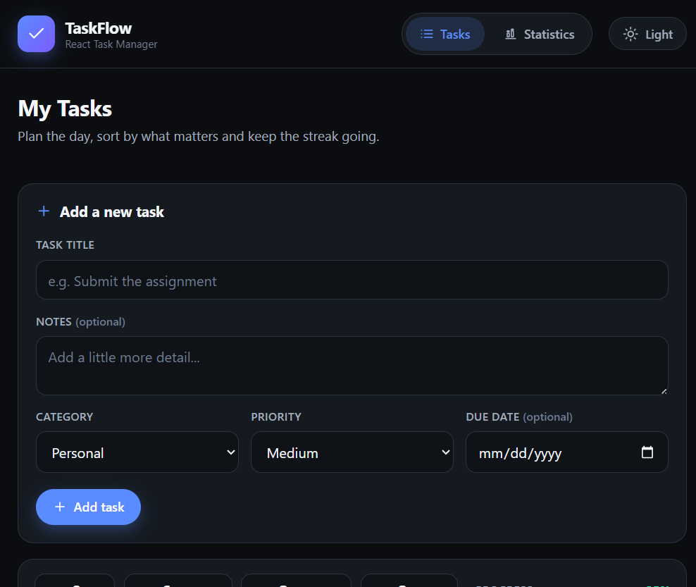
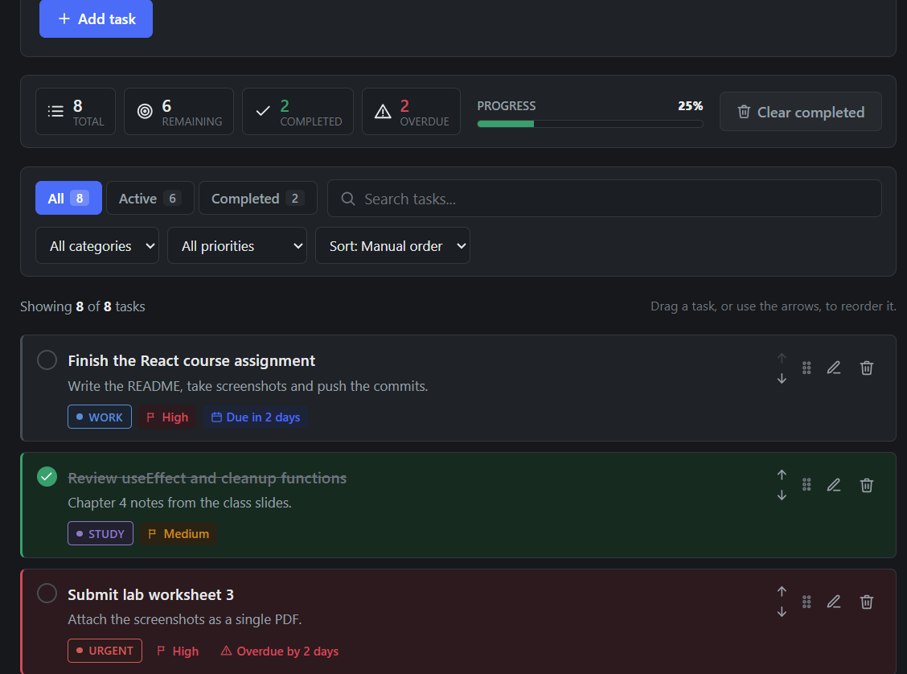
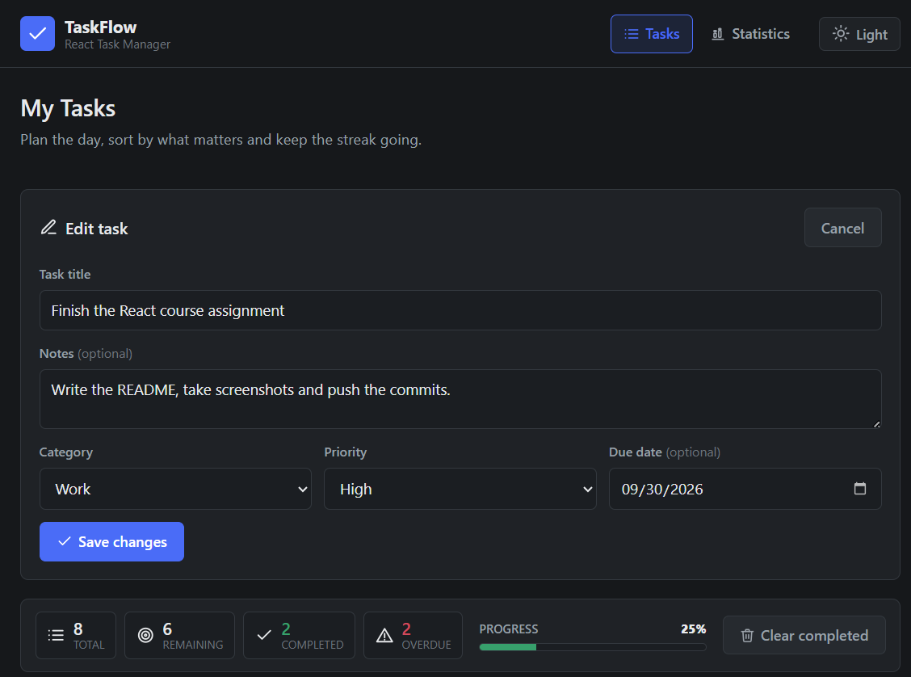
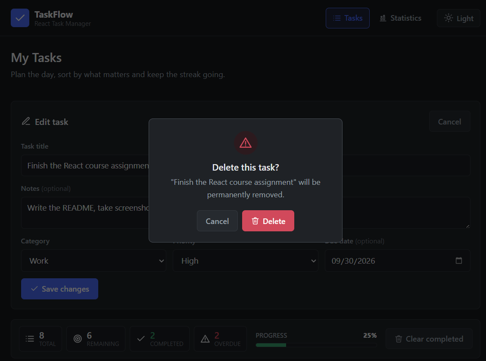
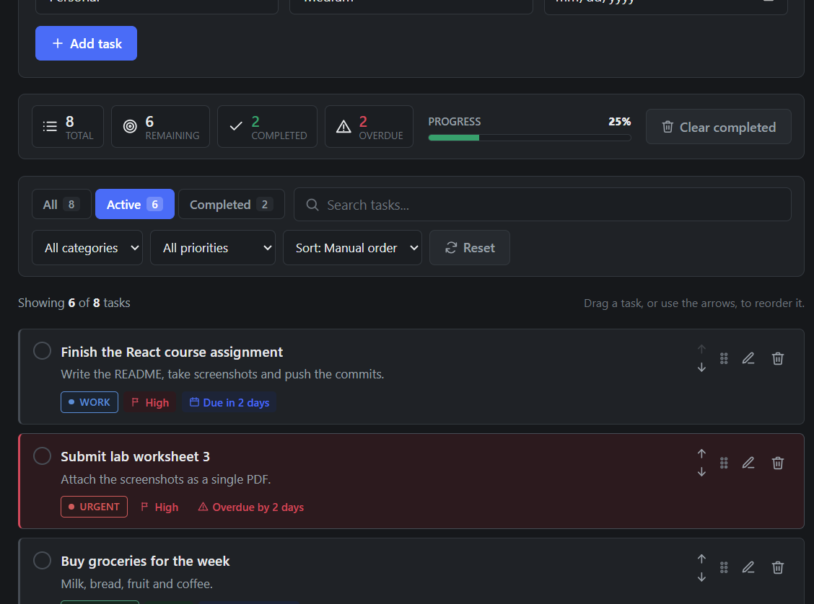
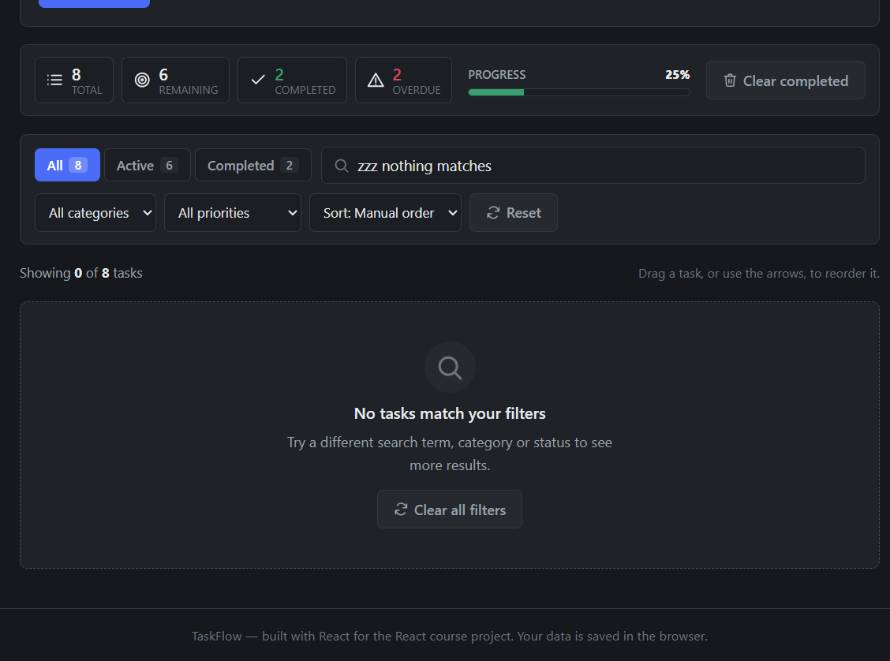
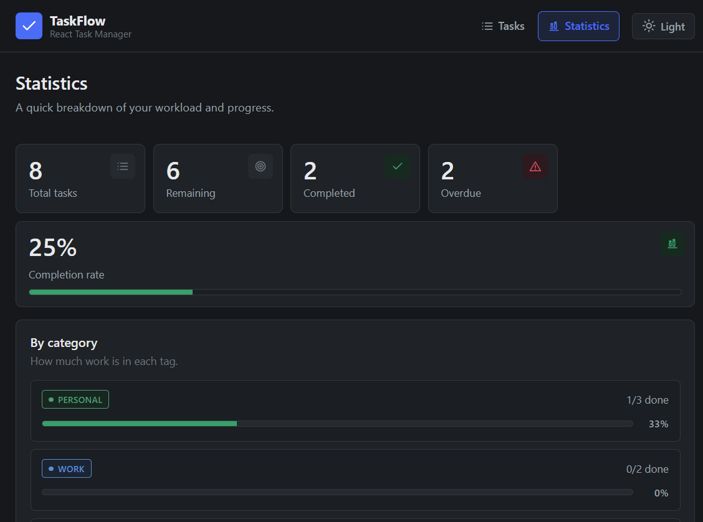
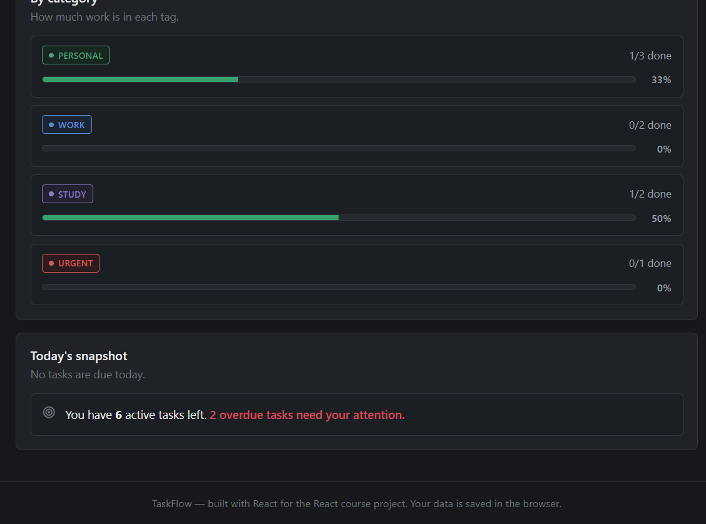
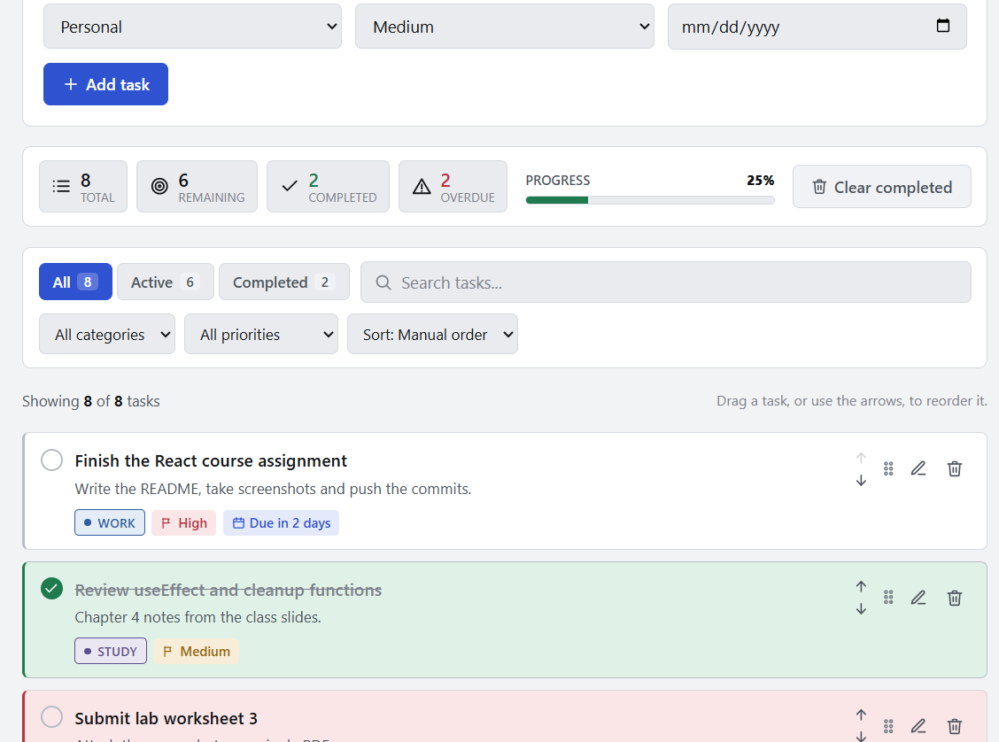
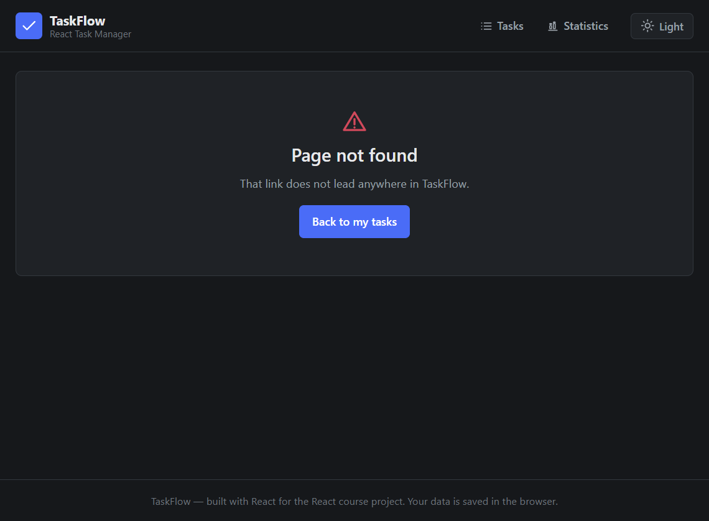

# TaskFlow — React Task Manager

TaskFlow is a single-page task manager built with React. It lets a user add, edit, delete and
complete tasks, organise them into categories with priorities and due dates, and filter the list
down to whatever matters right now. Everything is saved in the browser, so the list is still
there after a page refresh.



---

## Table of Contents

1. [Features](#features)
2. [Technologies Used](#technologies-used)
3. [Project Structure](#project-structure)
4. [Setup Instructions](#setup-instructions)
5. [Screenshots](#screenshots)
6. [How the Requirements Are Met](#how-the-requirements-are-met)
7. [Known Limitations](#known-limitations)
8. [References](#references)

---

## Features

### Core features (required by the brief)

- **Create, read, update, delete (CRUD) tasks** — add a new task, edit any field of an existing
  task, delete a task and mark it as complete or reopen it.
- **Filter by status** — `All`, `Active` and `Completed` tabs, each showing a live count.
- **Organise into categories** — every task belongs to one of `Work`, `Personal`, `Urgent` or `Study`,
  shown as a small coloured tag.
- **Persistence with `localStorage`** — tasks, filters and the chosen theme are all restored after
  a refresh, using a reusable `useLocalStorage` hook.
- **Live task counts** — total, remaining, completed and overdue counts, plus a progress bar that
  updates the moment anything changes.
- **Controlled form** — title, notes, category, priority and due date are all controlled inputs
  with validation before the task is saved.
- **Conditional rendering** — empty list, "no results match your filters" state, overdue styling,
  editing mode and a delete confirmation dialog are all rendered conditionally.

### Stretch goals (bonus features that were completed)

- **Drag-and-drop reordering** — tasks can be dragged into a new order using the browser's
  built-in HTML5 drag and drop, with no extra library.
- **Due dates with visual indicators** — due dates show as `Due today`, `Due tomorrow`,
  `Overdue by 3 days` and so on, and overdue tasks get a red border and a red label.
- **Dark / light theme toggle** — the choice is remembered in `localStorage` and applied through
  CSS variables.
- **Search box** — filter tasks by title, notes or category as you type.
- **Six sort options** — manual order, newest, oldest, due date, priority and name.
- **Priority levels** — `Low`, `Medium` and `High`, each with its own colour.
- **Keyboard-friendly reordering** — up/down arrow buttons next to every task, so reordering does
  not depend on a mouse.
- **Statistics page** — a second route with KPI cards, a completion-rate bar and a per-category
  breakdown.
- **Clear completed** — remove all finished tasks in one click.

---

## Technologies Used

| Technology | Version | Why it was used |
|---|---|---|
| [React](https://react.dev) | 19.x | Functional components, hooks and one-way data flow |
| [Vite](https://vite.dev) | 8.x | Fast development server and production build |
| [react-router-dom](https://reactrouter.com) | 7.x | Client-side routing between the Tasks and Statistics pages |
| [OXLint](https://oxc.rs) | 1.x | Zero-config code linter used by `npm run lint` |
| Plain CSS | – | Custom properties (design tokens) for the dark and light themes |
| `localStorage` | – | Built-in browser API used for persistence |
| HTML5 Drag and Drop | – | Built-in browser API used for reordering tasks |

No CSS framework, UI kit or icon library is used, so the whole project is easy to read and has
very few dependencies.

---

## Project Structure

```
taskflow-todo-app/
├── .gitignore
├── .gitattributes
├── .oxlintrc.json
├── index.html                 Entry HTML file
├── package.json               Scripts and dependencies
├── vercel.json                Rewrite rule so React Router works when deployed
├── vite.config.js             Vite configuration
├── README.md                  This file
├── public/
│   └── favicon.svg            The brand mark shown on the browser tab
├── docs/
│   ├── TaskFlow-Project-Documentation.docx   APA 7th edition project documentation
│   └── screenshots/                           Screenshots used in the README and the documentation
└── src/
    ├── main.jsx               Connects App to the DOM (createRoot)
    ├── App.jsx                Root component: routes + shared task state
    ├── App.css                Page shell and shared page styles
    ├── index.css              Design tokens (CSS variables) and base styles
    ├── constants.js           Categories, priorities, filters, storage keys
    ├── components/            Reusable, presentational components
    │   ├── CategoryBadge.jsx  Coloured category tag
    │   ├── CategoryBadge.css
    │   ├── ConfirmDialog.jsx  Delete confirmation modal
    │   ├── ConfirmDialog.css
    │   ├── EmptyState.jsx     Shown when the list has no tasks
    │   ├── EmptyState.css
    │   ├── FilterBar.jsx      Status tabs, search, category, priority, sort
    │   ├── FilterBar.css
    │   ├── Header.jsx         Brand, navigation and theme toggle
    │   ├── Header.css
    │   ├── Icon.jsx           Small inline SVG icon set
    │   ├── StatsPanel.jsx     Live counts and progress bar
    │   ├── StatsPanel.css
    │   ├── TaskForm.jsx       Add / edit form with controlled inputs
    │   ├── TaskForm.css       Also holds the shared .card and .btn styles
    │   ├── TaskItem.jsx       A single task row
    │   ├── TaskItem.css
    │   ├── TaskList.jsx       Renders the list with .map() and keys
    │   └── TaskList.css
    ├── hooks/                 Custom hooks
    │   ├── useFilters.js      Filter state + memoised visible list
    │   ├── useLocalStorage.js State that syncs with the browser
    │   ├── useTasks.js        All task actions in one place
    │   └── useTheme.js        Dark / light mode
    ├── pages/                 Route-level components
    │   ├── Home.jsx           Task manager page
    │   ├── Home.css
    │   ├── NotFound.jsx       404 page
    │   ├── Stats.jsx          Statistics page
    │   └── Stats.css
    └── utils/                 Pure helper functions
        ├── dateUtils.js       Date formatting and due-date status
        └── taskUtils.js       Filtering, sorting, statistics, reordering
```

### Data flow

The task array is owned by `App.jsx` through the `useTasks` hook. `App` passes the array and the
action functions down as **props** to `Home`, which passes them further down to `TaskList` and then
to each `TaskItem`. Nothing writes to the task list except the action functions, so the data always
flows in one direction.

```
App.jsx  ──(tasks + actions as props)──►  Home.jsx
                                             │
                       ┌─────────────────────┼──────────────────────┐
                       ▼                     ▼                      ▼
                  TaskForm            FilterBar / StatsPanel     TaskList
                                                                  │
                                                                  ▼
                                                              TaskItem
```

---

## Setup Instructions

### Requirements

- [Node.js](https://nodejs.org) 18 or newer (Node 20+ recommended)
- [npm](https://docs.npmjs.com) 9 or newer

Check your versions:

```bash
node --version
npm --version
```

### Install and run

```bash
# 1. Clone the repository
git clone https://github.com/<your-username>/taskflow-todo-app.git

# 2. Go into the project folder
cd taskflow-todo-app

# 3. Install the dependencies
npm install

# 4. Start the development server
npm run dev
```

Vite prints the local address in the terminal, usually <http://localhost:5173>. Open that address
in your browser and the app is running.

### Other useful scripts

| Command | What it does |
|---|---|
| `npm run dev` | Starts the development server with hot reload |
| `npm run build` | Creates an optimised production build in `dist/` |
| `npm run preview` | Serves the production build locally to check it |
| `npm run lint` | Runs OXLint over the source files |

### Troubleshooting

- **Port already in use** — run `npm run dev -- --port 3000` to use a different port.
- **The task list is empty** — the data is stored per browser. If you cleared site data, or you
  are using a different browser or a private window, the sample tasks load again.
- **`npm` is blocked on Windows PowerShell** — use `npm.cmd` instead of `npm`.

---

## Screenshots

All ten screenshots are also reproduced with captions and descriptions in
[`docs/TaskFlow-Project-Documentation.docx`](docs/TaskFlow-Project-Documentation.docx).

### 1. Add / edit form, live summary panel and filter bar

The form is a controlled form: every field is validated before the task is saved, and the panel
below it shows the totals updating live.


### 2. Task list with categories, priorities, due dates and reordering

Each task shows a coloured category tag, a priority label and a due-date label. Overdue tasks are
highlighted in red. Tasks can be dragged by the grip handle, or moved with the arrow buttons.



### 3. Editing an existing task

Pressing the pencil icon loads the task values into the same form and turns the submit button
into Save changes.



### 4. Delete confirmation dialog

Nothing is deleted immediately — the dialog names the task and asks for confirmation.



### 5. Filtered to `Active` only

The status tabs, the search box and the dropdown filters all combine together, and the tab counts
update to match.



### 6. Empty state when nothing matches the filters



### 7. Statistics page — summary cards and completion rate

A second route built with React Router, showing total, remaining, completed, overdue and the
completion rate.



### 8. Statistics page — per-category breakdown

Each category gets a progress bar showing how much of that category is already completed.



### 9. Light theme

The theme button in the header switches the whole interface between the dark and light palettes.



### 10. Not found page



---

## How the Requirements Are Met

| Requirement from the brief | Where it is implemented |
|---|---|
| Functional components only | Every component is a function; no class components are used |
| 4–5 or more reusable components | 10 components: `Header`, `TaskForm`, `FilterBar`, `TaskList`, `TaskItem`, `CategoryBadge`, `StatsPanel`, `EmptyState`, `ConfirmDialog`, `Icon` |
| Props for parent → child data flow | `App` → `Home` → `TaskList` → `TaskItem`, including callback props such as `onToggle` and `onDelete` |
| At least one `useState` feature | Task array, filters, editing, delete confirmation, drag state, theme |
| At least one `useEffect` | `useLocalStorage` writes to `localStorage`; `useTheme` applies `data-theme` to `<html>` |
| List rendering with `.map()` and unique keys | `TaskList.jsx` maps the array and uses `key={task.id}` |
| Controlled form with `onChange` / `onSubmit` | `TaskForm.jsx` |
| Conditional rendering | `EmptyState`, `ConfirmDialog`, overdue classes, edit mode, disabled buttons |
| React Router for more than one view | Routes `/` (Home), `/stats` (Stats) and `*` (NotFound) |
| Responsive layout | Media queries at 720 px and 640 px in the component CSS files |
| No unused code, no console errors | Verified with `npm run lint` and the browser console |
| Meaningful Git commits | Conventional Commit history — `chore`, `feat`, `style`, `docs` |

---

## Known Limitations

- **Single user, single device.** Data lives in `localStorage`, so there is no account, no server
  and no sync between browsers or devices. Clearing site data deletes the list.
- **No recurring tasks.** A task can be given a due date but cannot repeat daily, weekly or
  monthly.
- **Reordering and sorting are mutually exclusive.** Drag-and-drop is only enabled while the sort
  option is set to `Manual order`, because a sorted list has a fixed order defined by the sort.
- **No subtasks, attachments or comments.** A task is a single flat record with a short note.
- **No automated tests.** The project was written for a course assignment and verified manually in
  the browser; a `Vitest` + React Testing Library suite would be the next step.
- **Icons are hand-written inline SVGs.** They cover the icons the app needs, but there is no full
  icon set like Lucide or Feather would provide.
- **No offline service worker.** The app needs to be served over HTTP to run, so it cannot be
  installed as a PWA.
- **Not deployed yet.** A `vercel.json` with a rewrite rule is included, so the app can be deployed
  to Vercel with no extra configuration, but no live link is published at the time of writing.

---

## References

- React documentation — <https://react.dev>
- React `useState` hook — <https://react.dev/reference/react/useState>
- React `useEffect` hook — <https://react.dev/reference/react/useEffect>
- React `useMemo` hook — <https://react.dev/reference/react/useMemo>
- React `useCallback` hook — <https://react.dev/reference/react/useCallback>
- Thinking in React — <https://react.dev/learn/thinking-in-react>
- Sharing state between components — <https://react.dev/learn/sharing-state-between-components>
- React Router documentation — <https://reactrouter.com>
- Vite documentation — <https://vite.dev/guide/>
- MDN: `localStorage` — <https://developer.mozilla.org/en-US/docs/Web/API/Window/localStorage>
- MDN: HTML Drag and Drop API — <https://developer.mozilla.org/en-US/docs/Web/API/HTML_Drag_and_Drop_API>
- MDN: `Array.prototype.map()` — <https://developer.mozilla.org/en-US/docs/Web/JavaScript/Reference/Global_Objects/Array/map>
